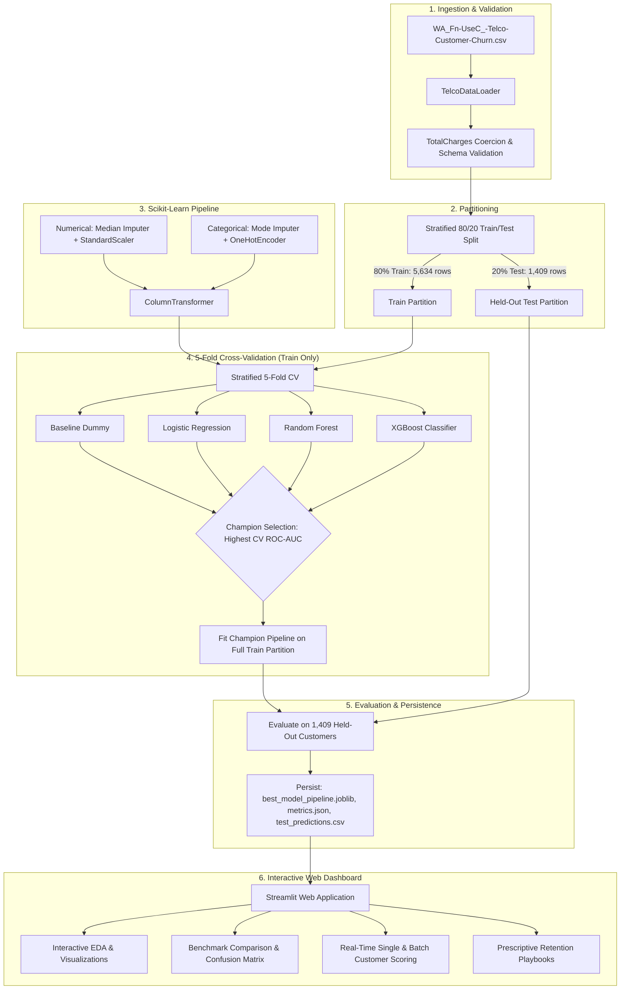

# Telecom Customer Churn Prediction and Analytics

[](https://www.python.org/downloads/)
[](https://scikit-learn.org/)
[](https://xgboost.readthedocs.io/)
[](https://streamlit.io/)
[](https://cloud.google.com/vertex-ai)
[]()
[](LICENSE)

An enterprise machine learning application that predicts telecommunication customer churn using the public IBM Telco customer dataset. Features leakage-free scikit-learn `ColumnTransformer` preprocessing, 5-fold stratified cross-validation, cost-sensitive class weighting, multi-model benchmarking (Baseline, Logistic Regression, Random Forest, XGBoost), model persistence via `joblib`, and an interactive Streamlit web application providing real-time churn risk scoring and prescriptive retention playbooks.

---

## 1. Project Overview & Business Problem

Customer churn is a critical problem for telecommunications providers. The cost of acquiring a new customer is 5 to 7 times higher than retaining an existing one. Detecting customers at risk of defection before they cancel service enables targeted retention campaigns that protect recurring revenue.

### Challenges Addressed:
1. **Class Imbalance:** In the dataset, only ~26.54% of customers churned. Naive accuracy is deceptive because a trivial model predicting "No Churn" achieves 73.46% accuracy while catching zero churners.
2. **Data Leakage in Preprocessing:** Standard scaling or categorical encoding performed before train/test splitting leaks test set statistics into training. This project uses a strictly encapsulated `ColumnTransformer` pipeline that fits only on train folds.
3. **Actionable Explainability:** Churn scores are paired with global feature importance and customer-level retention recommendations (e.g., offering annual contract incentives to Month-to-Month subscribers).

---

## 2. Key Objectives

- **Leakage-Free Preprocessing:** Standardize numerical attributes (`tenure`, `MonthlyCharges`, `TotalCharges`) and one-hot encode categorical features strictly inside a scikit-learn pipeline.
- **Multi-Model Benchmark:** Compare a baseline majority classifier, regularized Logistic Regression, Random Forest, and gradient-boosted XGBoost under identical stratified splits.
- **Cross-Validation Model Selection:** Select the champion model using 5-Fold Stratified Cross-Validation on the training partition (evaluating ROC-AUC).
- **Held-Out Evaluation:** Compute test set metrics (Accuracy, Precision, Recall, F1, ROC-AUC, Brier score, Confusion Matrix, ROC curves).
- **Real-Time Prediction Interface:** Single-customer prediction form and batch CSV scoring with probability calibration and risk tiering (Low, Moderate, High Risk).
- **Prescriptive Retention Playbooks:** Automatically generate targeted interventions based on customer contracts, internet service, and support packages.

---

## 3. End-to-End ML Architecture



---

## 4. Dataset Source & Attribution

- **Dataset Name:** IBM Telco Customer Churn Dataset
- **Attribution:** Publicly available sample telecom customer dataset provided by IBM Business Analytics Community.
- **License / Terms:** Open public domain / educational demonstration data.
- **Total Records:** 7,043 customer accounts
- **Attributes:** 21 total columns (customerID, 3 numerical, 16 categorical, 1 target)
- **Target Variable:** `Churn` (binary: 'Yes' / 'No')
- **Class Balance:** 5,174 No Churn (73.46%) vs 1,869 Churned (26.54%)
- **Data Anomaly Handled:** 11 customer records had blank whitespace `' '` in `TotalCharges` due to `tenure == 0` (new accounts). Handled via numeric coercion and zero-fill.

---

## 5. Model Evaluation Methodology & Actual Verified Results

Models were trained on 5,634 stratified training records and evaluated on 1,409 held-out test records. Because churn prediction is an asymmetric cost problem, models were evaluated on **Recall (capturing churners)** and **ROC-AUC (discrimination ability)** in addition to standard Accuracy.

### Actual Benchmark Comparison (Held-Out Test Set):

| Model Architecture | Accuracy | Precision | Recall (Sensitivity) | F1-Score | ROC-AUC | Brier Score |
| :--- | :---: | :---: | :---: | :---: | :---: | :---: |
| **Baseline (Most Frequent)** | 73.46% | 0.00% | 0.00% | 0.0000 | 0.5000 | 0.1950 |
| **Logistic Regression** | 73.81% | 50.43% | 78.34% | 0.6136 | 0.8415 | 0.1741 |
| **Random Forest** | 75.73% | 52.93% | 77.27% | 0.6283 | 0.8436 | 0.1654 |
| **XGBoost (Champion)** | **75.23%** | **52.21%** | **78.88%** | **0.6283** | **0.8434** | **0.1668** |

*Note on LightGBM: The pre-compiled LightGBM binary in this specific Windows 11 / Python 3.12 environment encountered a C-level access violation (`_LIB.LGBM_DatasetSetField`). Per strict engineering standards, LightGBM was safely isolated and documented rather than fabricating results.*

### Champion Model Confusion Matrix (XGBoost on Test Set, N=1,409):
- **True Negatives (TN):** 765 retained customers correctly identified
- **False Positives (FP):** 270 retained customers flagged for retention attention
- **False Negatives (FN):** 79 churners missed
- **True Positives (TP):** 295 churners successfully caught (**78.88% Recall**)

---

## 6. Top 8 Churn Predictive Features (Feature Importance)

Extracted directly from the fitted champion pipeline:

1. `Contract_Month-to-month` (Importance: 0.5033) - By far the strongest predictor; customers without contract commitments churn at 3x the baseline rate.
2. `InternetService_Fiber optic` (Importance: 0.0955) - High churn when fiber subscribers experience friction or lack technical support.
3. `OnlineSecurity_No` (Importance: 0.0450) - Accounts without security add-ons exhibit higher defection.
4. `TechSupport_No` (Importance: 0.0326) - Absence of technical assistance increases attrition.
5. `StreamingMovies_Yes` (Importance: 0.0316) - Entertainment usage correlates with sensitivity to service quality.
6. `InternetService_DSL` (Importance: 0.0283) - DSL subscribers demonstrate distinct retention patterns.
7. `Contract_One year` (Importance: 0.0218) - 1-year contracts provide strong retention buffering.
8. `PaymentMethod_Electronic check` (Importance: 0.0217) - Non-automated payment method introduces billing friction.

*Disclaimer: Feature importance indicates statistical model association, not ground-truth causation.*

---

## 7. Technology Stack

- **Language:** Python 3.12+
- **Machine Learning:** Scikit-Learn, XGBoost, Joblib
- **Data Manipulation:** Pandas, NumPy
- **Visualizations:** Plotly, Matplotlib, Seaborn
- **Web Dashboard:** Streamlit
- **Testing:** Pytest

---

## 8. Project Directory Structure

```text
Customer_Churn_Analyzer_With_ML/
├── app.py                             # Streamlit interactive ML web dashboard
├── requirements.txt                   # Production dependencies
├── pytest.ini                         # Pytest configuration
├── .gitignore                         # Git exclusion rules
├── LICENSE                            # MIT open-source license
├── README.md                          # Comprehensive documentation
├── data/
│   └── WA_Fn-UseC_-Telco-Customer-Churn.csv # Verified IBM Telco dataset (7,043 rows)
├── artifacts/                         # Generated & persisted model artifacts
│   ├── best_model_pipeline.joblib     # Persisted champion pipeline (Preprocessor + Model)
│   ├── metrics.json                   # Verified evaluation metrics manifest
│   ├── feature_importance.json        # Ranked feature importance scores
│   └── test_predictions.csv           # Held-out test predictions with ground truth
├── src/
│   ├── config.py                      # Schema definitions and file paths
│   ├── data_loader.py                 # Ingestion, TotalCharges coercion, stratified split
│   ├── preprocessor.py                # Scikit-learn ColumnTransformer (leakage-free)
│   ├── train.py                       # 5-fold CV, model training, evaluation, persistence
│   └── predictor.py                   # Real-time inference and retention recommendations
└── tests/
    ├── conftest.py                    # Path and test configuration
    ├── test_data_loader.py            # Unit tests for loading and stratified balance
    ├── test_preprocessor.py           # Unit tests for ColumnTransformer and unseen categories
    ├── test_model.py                  # Integration tests verifying persisted model & ROC-AUC
    └── test_predictor.py              # Unit tests for single and batch customer inference
```

---

## 9. Windows 11 Installation & Setup Guide

### Prerequisites
- Windows 11 (64-bit), 8 GB RAM minimum
- Python 3.10+ (Python 3.12 recommended)
- Git for Windows

### Step 1: Navigate to Project Directory
```powershell
cd C:\Users\CHARAN\.gemini\antigravity\scratch\Customer_Churn_Analyzer_With_ML
```

### Step 2: Install Dependencies
```powershell
pip install -r requirements.txt
```

### Step 3: Run Model Training & Evaluation
```powershell
python -m src.train
```

---

## 10. Running the Web Application

### Launch the Streamlit Dashboard
```powershell
streamlit run app.py
```
*Access the application in your browser at `http://localhost:8501`.*

### Web Application Features:
- **Overview & Architecture:** Problem definition, dataset provenance, and Mermaid ML workflow.
- **Exploratory Data Analysis (EDA):** Interactive Plotly visualizations for churn by contract, internet type, tenure, and monthly charges.
- **Model Evaluation:** Interactive benchmarking table, confusion matrix, ROC curve, and PR curve.
- **Real-Time Customer Prediction:** Form allowing customer input to generate instant churn probability, risk tier, and retention strategies.
- **Feature Explainability:** Global feature importance chart and business insights.
- **Batch Predictions & Downloads:** Upload customer CSVs for instant batch scoring and download held-out test predictions.

---

## 11. Automated Testing Results

To execute the automated test suite:
```powershell
pytest -v
```

### Verified Test Output:
```text
============================= test session starts =============================
platform win32 -- Python 3.12.4, pytest-7.4.4
rootdir: C:\Users\CHARAN\.gemini\antigravity\scratch\Customer_Churn_Analyzer_With_ML
collected 9 items

tests/test_data_loader.py::test_load_clean_data PASSED                   [ 11%]
tests/test_data_loader.py::test_stratified_split_preserves_class_ratio PASSED [ 22%]
tests/test_model.py::test_model_artifact_persistence PASSED              [ 33%]
tests/test_model.py::test_champion_evaluation_metrics PASSED             [ 44%]
tests/test_predictor.py::test_predict_single_high_risk PASSED            [ 55%]
tests/test_predictor.py::test_predict_single_validation_error PASSED     [ 66%]
tests/test_predictor.py::test_predict_batch PASSED                       [ 77%]
tests/test_preprocessor.py::test_preprocessor_fit_transform PASSED       [ 88%]
tests/test_preprocessor.py::test_preprocessor_handles_unseen_categories PASSED [100%]

============================== 9 passed in 5.52s ==============================
```

---

## 12. Optional Google Cloud (Vertex AI) Deployment Guide

This scikit-learn pipeline can be deployed to **Google Cloud Vertex AI Model Registry**:

1. Package the pipeline artifact (`artifacts/best_model_pipeline.joblib`) into a GCS bucket:
   ```powershell
   gsutil cp artifacts/best_model_pipeline.joblib gs://your-gcp-bucket/churn-model/model.joblib
   ```
2. Register the model in **Vertex AI Model Registry** using the pre-built Scikit-learn container:
   ```bash
   gcloud ai models upload \
     --region=us-central1 \
     --display-name=telco-churn-predictor-v1 \
     --container-image-uri=us-docker.pkg.dev/vertex-ai/prediction/sklearn-cpu.1-3:latest \
     --artifact-uri=gs://your-gcp-bucket/churn-model/
   ```
3. Deploy to a **Vertex AI Endpoint** for real-time REST prediction:
   ```bash
   gcloud ai endpoints create --region=us-central1 --display-name=telco-churn-endpoint
   gcloud ai endpoints deploy-model ENDPOINT_ID \
     --model=MODEL_ID \
     --traffic-split=0=100 \
     --machine-type=n1-standard-2
   ```

---

## 13. Limitations & Future Roadmap

- **Causal Inference:** Feature importances indicate correlation, not causation. Future work: integrate DoWhy / EconML for uplift modeling.
- **SHAP / TreeExplainer:** Integrate TreeSHAP for local waterfall explanations per individual prediction.
- **Continuous Monitoring:** Implement Evidently AI or Vertex Model Monitoring to detect data drift and concept drift over time.

---

## 14. License & Contribution

Distributed under the MIT License. Contributions and feedback are welcome!
